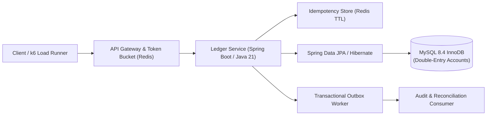

# pulseledger-microservices

> **Double-Entry Idempotent Settlement Service**  
> *Java 21 • Spring Boot 3.5 • Spring Data JPA / Hibernate • MySQL 8.4 • Redis 7.4 • Optimistic Locking • Transactional Outbox*

[](#)
[](https://openjdk.org/projects/jdk/21/)
[](https://spring.io/projects/spring-boot)
[](https://www.mysql.com/)
[](LICENSE)

---

## Problem Statement

Financial settlement engines require strict mathematical guarantees: account balances must never drift, concurrent transfers must never trigger race conditions, and network retries must never double-debit funds. **PulseLedger** translates core DBMS, Operating Systems, and Distributed Systems principles into an idempotent double-entry ledger.

---

## Architectural Dataflow



---

## Engineering Trade-Offs

- **Optimistic Locking (`@Version`) vs. Pessimistic Locking (`SELECT ... FOR UPDATE`):**
  - High-throughput non-overlapping transactions achieve maximum concurrency under optimistic locking without database row-lock contention.
  - Hot accounts automatically trigger exponential backoff retries before failure.
- **Transactional Outbox Pattern:**
  - Guarantees at-least-once message delivery for audit logging and reconciliation without distributed 2-Phase Commit (2PC) bottlenecks.
- **Modern Docker Compose Spec:**
  - Modern spec omitting the obsolete top-level `version` key for clean zero-warning orchestration.

---

## Quick Start (Docker Compose)

```bash
docker compose up -d
```

### Transfer Verification:
```bash
curl -X POST http://localhost:8080/api/v1/ledger/transfers \
  -H "Content-Type: application/json" \
  -H "Idempotency-Key: tx-2026-001" \
  -d '{"sourceAccount": "ACC-001", "destinationAccount": "ACC-002", "amount": 250.00}'
```

---

## Author & License

- Engineered by **Prajwal Jogi** ([@prajwal918](https://github.com/prajwal918))
- Licensed under the [MIT License](LICENSE).
